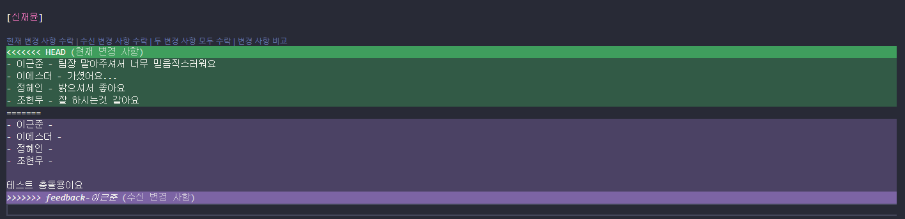

# git-study-team

git-study-team

* 팀원 각자 저장이랑 커밋이 뭐가 다른지, 본인 나름대로 이해한 대로 2\~3줄씩 써주세요. 교과서적으로 작성하지 않으셔도 됩니다.

  * 이근준 - 저장은 덮어쓰는 느낌, 커밋은 기록남겨서 스냅샷 찍어 백업 가능하게 하는 느낌
  * 조현우 - 각자 저장은 로컬에 그냥 냅두는 자기 전용. 커밋은 저장소에 올려 공유 또는 백업을 하는 개념.
  * 이에스더 -
  * 정혜인 - 저장은 개인 커밋은 공유
  * 신재윤 - 저장은 내 변경사항을 고정하는 것, 커밋은 지금 현재의 상황을 과거 기록과 함께 그대로 포장해서 내 로컬 파일에 넣는 것

* 언제/왜 Pull을 먼저 했는지, 안 하면 어떻게 되는지 겪어봤다면 그 얘기도

  * 이근준 - pull 하지 않으면 겹쳐서 문제가 발생함
  * 조현우 - PULL을 먼저 안하면, 내 작업이랑 겹쳐서 충돌이 날 수 있으니까.
  * 이에스더 - pull 먼저 안함. 작업이 겹쳐서 충돌이 남.
  * 정혜인 - PULL이 겹쳐 충돌이 남
  * 신재윤 - 앞 사람이 작업 후, 안하면 충돌이 일어남

* Commit 메시지 뭐라고 썼는지, Push 눌렀을 때 결과가 어땠는지

  * 이근준 - 수정내용 입력 push했을 때 해당 브랜치나 메인파일 변경 확인
  * 조현우 - 일단은 기본 커밋 메시지로, PUSH를 눌렀을 때, 원격 레포지토리에 반영되는 것 확인
  * 이에스더 - 그냥 이름 썼음. 겹쳐서 충돌. 수정후 반영이 됨.
  * 정혜인 - 이름과 인사, 세이브 파일이 공유됨
  * 신재윤 - 그냥 빈칸 평소엔 커밋룰에 의거, 푸쉬 시 해당 브랜치로 병합됨

* 본인 차례를 기다리는 동안 다른 사람 화면에서(혹은 GitHub Desktop History 탭에서) 뭐가 보였는지

  * 이근준 - 기록들이 보입니다.
  * 조현우 - 커밋 메시지 및 기록 보임
  * 이에스더 - 각자의 작업 기록이 보임
  * 정혜인 - 변경사항들이 보임
  * 신재윤 - 변경사항들

* 브랜치는 각자 뭐라고 이름 지었는지

  * 이근준 - feeback-이근준
  * 조현우 - feedback-현우
  * 이에스더 - 
  * 정혜인 - feedback-정혜인
  * 신재윤 - feedback-신재윤

* merge를 총 몇 번 했는지, 순서대로 어떻게 진행했는지

  * 총 4번 순서는 재윤님->혜인님->현우->근준 순으로 진행

* 충돌은 어느 파일, 어느 줄에서 났는지, 화면에 뭐가 떴는지, 어떻게 골라서 해결했는지 (스크린샷 있으면 좋음)

  * 충돌은 review.md파일에서 났으며, 화면은 스크린샷 참조 바람, vscode로 병합하여 수정

* 누가, 왜 stash를 써야 하는 상황이었는지

  * A 작업자가 본인 브랜치에서 코드 쓰다가, B작업자 브랜치로 넘어가서 코드를 참고하고 싶었음

* stash 전/후 GitHub Desktop 화면이 어떻게 달랐는지

  * changes -> stashed changes로 변경사항이 넘어감

* Restore 했을 때 원래 작업이 그대로 돌아왔는지

  * 그대로 돌아왔음

